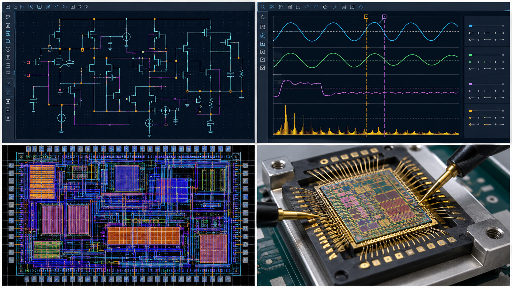
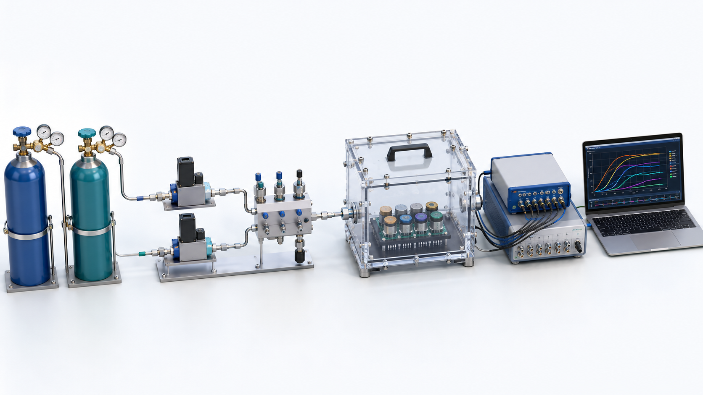
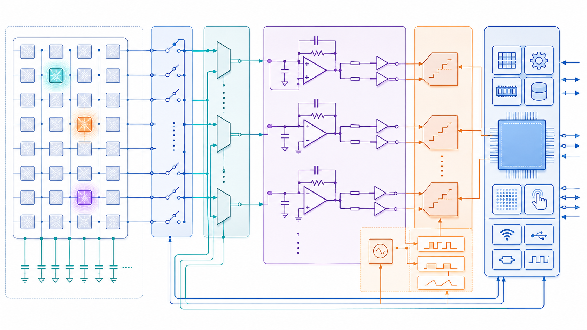
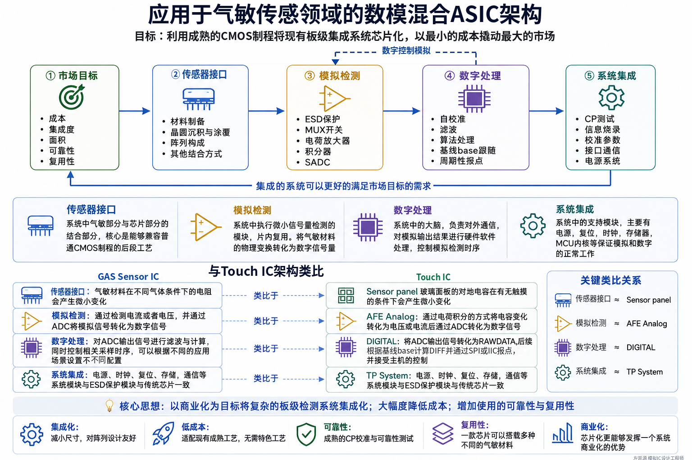
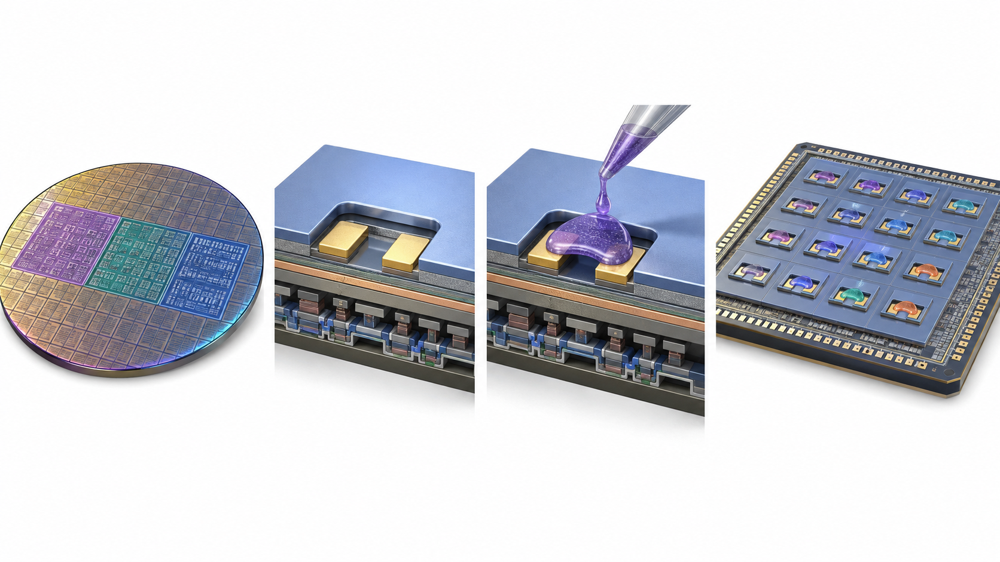
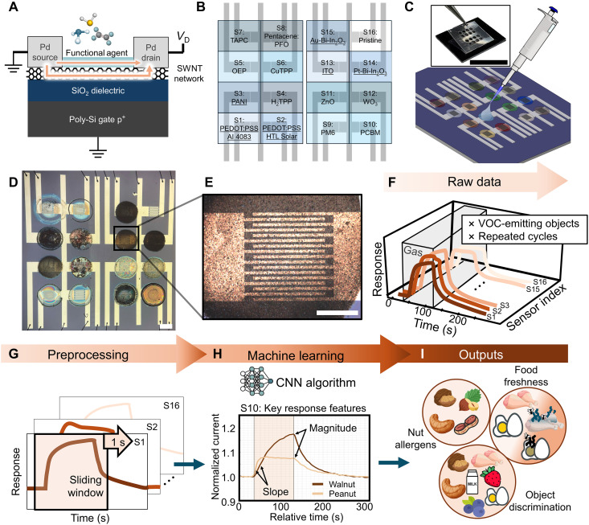
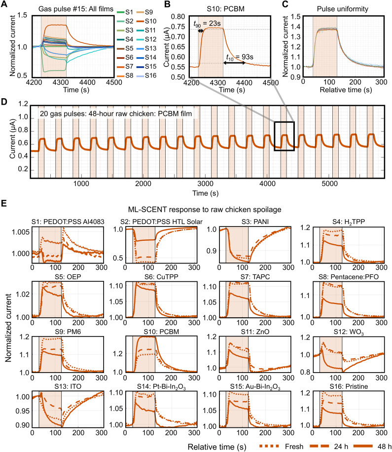
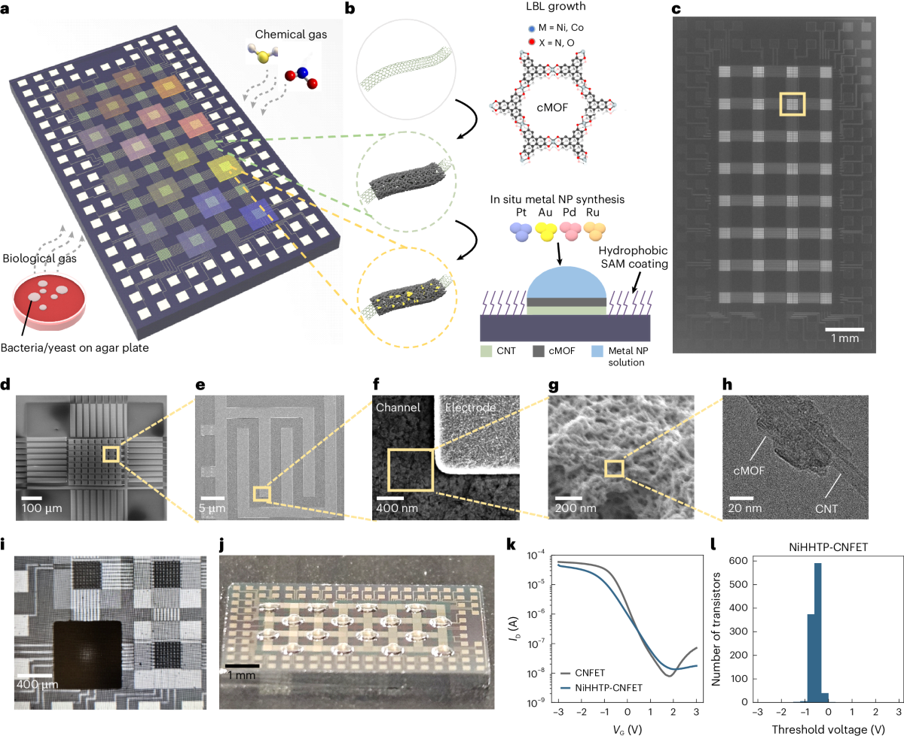
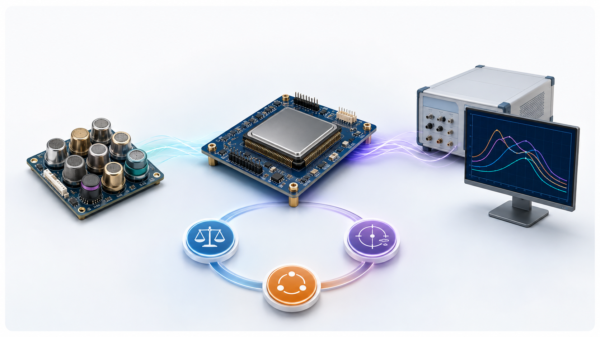

## CMOS 兼容气敏传感器接口芯片研究 {.cover-slide}

```{=html}
<div class="cover-grid">
  <div class="cover-main">
    <p class="eyebrow">SCHOOL RESEARCH SEMINAR</p>
    <h1>从传感器响应<br>到<span>可验证的芯片系统</span></h1>
    <p class="cover-sub">面向气敏阵列的数模混合接口、主动扫描与系统集成</p>
    <div class="cover-author"><strong>左凯源</strong><span>模拟 IC 设计工程师</span><time>2026.9.10</time></div>
    <div class="cover-scope"><b>本次讨论</b><span>接口范围</span><span>板级扩展限制</span><span>Touch IC 方法迁移</span><span>首颗芯片验证</span></div>
  </div>
  <div class="cover-logic">
    <div class="sensor-stage"><em>01</em><b>传感器端</b><span>输出范围 · 偏置 · 时间特征 · 环境条件</span></div><i></i>
    <div class="chip-stage"><em>02</em><b>芯片端</b><span>AFE · ADC · 校准 · 数字控制</span></div><i></i>
    <div class="verify-stage"><em>03</em><b>验证端</b><span>参考链路 · 联测平台 · 失败归因</span></div>
  </div>
</div>
<div class="cover-foot">研究设想与方法交流 · 具体指标以实验和设计预算为准</div>
```

::: {.notes}
计划时长：1 分钟

### 口述正文

各位老师、同学，大家好，我是左凯源，目前从事模拟 IC 设计。今天想和大家交流一个把我研究生阶段和工作阶段连接起来的问题，也就是能不能用成熟 CMOS 工艺，为气敏传感器阵列做一颗通用的数模混合接口芯片。

这不是一颗已经完成的产品，也不是一次商业路演。今天报告的重点是把研究问题讲清楚：材料产生的电学变化怎样进入芯片，板级读出为什么难以扩展，哪些触控芯片中的方法可以借鉴，以及第一颗测试芯片应该验证什么。

我希望最后留下的不是一个看起来完整但尚未验证的方案，而是几个可以由材料、器件和电路共同回答的问题。

### 转场

先介绍一下，我为什么会从气敏材料走到这个芯片问题。

### 边界提醒

- 只使用“左凯源，模拟 IC 设计工程师”的身份口径，不出现雇主名称。
- 不使用“已经完成”“已经量产”或“可以直接产品化”等表述。
:::

## 这次交流讨论什么 {.timeline-slide}

```{=html}
<div class="section-tag">01 · 问题从哪里来</div>
<div class="experience-timeline">
  <div class="experience-side graduate"><span>研究生阶段</span><svg class="stage-icon" viewBox="0 0 96 96" aria-hidden="true"><path d="M18 72h60M28 68V42l20-18 20 18v26M39 68V51h18v17"/><circle cx="48" cy="22" r="7"/></svg><h3>材料、器件与实验条件</h3><p>关注响应、恢复、漂移，以及温度和气氛怎样改变器件输出。</p><small>观察对象：材料与器件</small></div>
  <div class="timeline-bridge"><b>同一条测量链</b><i></i><span>电学变化怎样进入芯片</span></div>
  <div class="experience-side work"><span>工作阶段</span><svg class="stage-icon" viewBox="0 0 96 96" aria-hidden="true"><rect x="24" y="24" width="48" height="48" rx="5"/><path d="M36 36h24v24H36zM12 34h12M12 48h12M12 62h12M72 34h12M72 48h12M72 62h12M34 12v12M48 12v12M62 12v12M34 72v12M48 72v12M62 72v12"/></svg><h3>模拟前端、ADC 与系统验证</h3><p>关注微弱信号怎样稳定转换、校准、组织并留下可回溯数据。</p><small>观察对象：电路与系统</small></div>
</div>
<div class="question-band"><b>本次问题</b><span>成熟 CMOS 工艺能否把两端连接成一套可验证的气敏读出系统？</span></div>
```

::: {.notes}
计划时长：1.5 分钟

### 口述正文

[指向时间线左侧] 我在研究生阶段主要接触气敏材料、器件制备、测试平台和多物理场仿真。当时关注的是材料怎样响应气体，温度场怎样分布，器件为什么会出现响应、恢复和漂移。

[指向时间线右侧] 工作以后，我的视角转到了芯片内部。一个微弱信号要稳定地变成数字量，中间需要模拟前端、通道扫描、模数转换、校准、时序控制和测试闭环。

这两段经历看似属于两个方向，实际观察的是同一条链路的两端。材料研究经常把重点放在灵敏度和选择性上，芯片设计则会继续追问：信号范围多大，噪声从哪里来，多个通道怎样同步，漂移怎样区分，系统怎样校准。

所以今天我不会试图替材料方向给出结论，而是把材料问题翻译成可测量、可设计、可验证的芯片问题，再请大家判断这个翻译是否合理。

### 转场

先从我实际做过的气敏研究讲起。

### 边界提醒

- 个人经历可以作为事实陈述，但不把个人经历扩展为行业普遍结论。
- 不展开公司、客户、产品和未公开项目细节。
:::

## 气敏研究经历与芯片问题 {.bridge-slide}

```{=html}
<div class="section-tag">01 · 问题从哪里来</div>
<div class="research-bridge">
  <div><svg class="card-icon" viewBox="0 0 80 80" aria-hidden="true"><path d="M18 62h44M25 58c0-20 10-34 15-40 5 6 15 20 15 40M28 42h24M33 30h14"/></svg><span>材料制备</span><small>材料变化能否形成稳定电学响应</small></div><i>›</i>
  <div><svg class="card-icon" viewBox="0 0 80 80" aria-hidden="true"><path d="M14 58h52M20 58V24h40v34M28 48l8-10 8 7 10-16"/><circle cx="54" cy="29" r="3"/></svg><span>器件与测试</span><small>响应、恢复和漂移怎样被记录</small></div><i>›</i>
  <div><svg class="card-icon" viewBox="0 0 80 80" aria-hidden="true"><rect x="14" y="22" width="52" height="38" rx="5"/><path d="M22 48c8-24 13 10 21-12s11 12 17-5M26 14v8M40 14v8M54 14v8"/></svg><span>微热板与仿真</span><small>激励条件和结构如何影响输出</small></div><i>›</i>
  <div class="accent"><svg class="card-icon" viewBox="0 0 80 80" aria-hidden="true"><rect x="20" y="20" width="40" height="40" rx="4"/><path d="M30 30h20v20H30zM8 32h12M8 48h12M60 32h12M60 48h12M32 8v12M48 8v12M32 60v12M48 60v12"/></svg><span>芯片接口问题</span><small>量程、噪声、采样和校准怎样定义</small></div>
</div>
```

::: {.notes}
计划时长：1 分钟

### 口述正文

研究生阶段，我接触过气敏材料制备、测试平台、硅基微加热板和多物理场仿真，也做过动态温度调制相关研究。今天面对的都是传感器专家，这部分我只交代经历，不展开材料机理。

这些工作给我留下的核心问题是：传感器输出并不是一个孤立数值，而是与激励条件、采样时刻和环境共同变化的电学信号。如果把激励、采样和多通道同步放进芯片，能否得到更稳定、更完整的数据，这才是今天要继续讨论的连接点。

### 转场

工作以后，我开始从另一端理解，芯片怎样把这些变化可靠地读出来。

### 证据与边界

- 个人经历由作者确认；公开版不附个人履历源文件。
- 公开展示时，实验图片、项目编号和具体测试数据仍需单独确认。
- 不罗列材料优劣，不以材料专家口吻评价具体传感机制。
- “主动扫描提高信息量”在此处是研究动机，后续需要定义可测指标。
:::

## 工作阶段的模拟 IC 设计 {.workflow-slide}

```{=html}
<div class="section-tag">01 · 问题从哪里来</div>
<div class="engineering-layout"><div class="engineering-visual"></div><div class="engineering-captions"><div><b>01 电路设计</b><span>输入范围 · 噪声预算 · AFE/ADC</span></div><div><b>02 仿真验证</b><span>PVT · 失配 · 噪声 · 建立时间</span></div><div><b>03 版图与集成</b><span>匹配 · 供电分区 · 顶层接口</span></div><div><b>04 芯片与测试</b><span>参考链路 · 校准 · 失效归因</span></div></div></div>
<div class="two-line-takeaway"><b>核心经验</b><span>一颗接口芯片的价值不只来自电路模块，而来自定义、测量、校准和测试能否形成闭环。</span></div>
<div class="generated-caption">AI 生成去敏示意 · 只证明工作内容类别，不代表真实项目截图或具体芯片证据</div>
```

::: {.notes}
计划时长：3 分钟

### 口述正文

工作阶段，我主要接触多通道模拟前端、ADC、校准和芯片顶层集成。为了方便材料背景的同学理解，可以把模拟前端，也就是 AFE，看成传感器和 ADC 之间的翻译器。它先把很小、很慢或者带有大基线的电信号，变成 ADC 能够处理的范围。

ADC 再把连续变化的电压或电流转换成数字码。得到数字码以后，系统还需要知道它来自哪个通道、在什么时刻采样、使用了什么增益，以及校准参数是否有效。任何一环没有对齐，最后得到的数据即使看起来平滑，也可能无法对应真实的材料变化。

多通道芯片还有一个重要特点：单通道工作正常，并不代表几十个通道同时工作也正常。通道切换会产生瞬态，数字时钟可能耦合到模拟输入，电源和衬底会传递干扰，器件偏差也会造成通道间差异。因此芯片设计关注的不只是某个放大器，而是信号链、时序、校准和测试能否形成闭环。

今天借鉴 Touch IC，主要借鉴的就是这种系统方法。具体电路参数仍然要按照气敏器件重新定义。

这也是传感器与芯片融合的第一个边界。材料端不需要先替芯片选择某一种放大器，芯片端也不能只拿一个理想电阻开始设计。双方需要先约定一组共同输入，包括阻值范围、允许偏置、变化速度、环境条件和阵列连接方式。只有这些接口条件明确以后，后面的 AFE、ADC 和校准才有工程意义。

### 转场

有了这两个视角，下面用很短的篇幅定义传感器交给芯片的信号，不展开大家已经熟悉的材料机理。

### 证据与边界

- 个人经历由作者确认；公开版不附个人履历源文件。
- 只讲通用方法，不披露真实芯片版图、内部模块细节或产品指标。
- “方法可借鉴”不等于现有 Touch IC 电路可以直接用于气敏传感器。
:::

## 传感器向芯片提供什么信号 {.signal-slide}

```{=html}
<div class="section-tag">02 · 气敏信号为何难读</div>
<div class="sensor-signal-map">
  <div class="gas-condition"><b>气体与环境条件</b><span>气体种类 · 浓度 · 温湿度 · 暴露时间</span></div><i>›</i>
  <div class="material-response"><b>材料与器件响应</b><span>不展开吸附机理，只观察电学变化</span></div><i>›</i>
  <div class="electrical-output"><b>芯片看到的输入</b><span>电阻 R(t) · 电压 V(t) · 电流 I(t)</span></div>
</div>
<div class="spec-row"><div><b>幅度</b><span>决定量程和增益</span></div><div><b>偏置</b><span>决定输入结构与功耗</span></div><div><b>时间</b><span>决定采样窗口和带宽</span></div><div><b>历史</b><span>决定基线与校准边界</span></div></div>
```

::: {.notes}
计划时长：1 分钟

### 口述正文

[指向传感器与芯片接口] 气敏机理大家比我更熟悉，这里只保留芯片需要看到的结果。对于本次聚焦的电阻式器件，材料和气体作用以后，芯片最终观察的是随时间变化的电阻，或者在给定偏置下对应的电压和电流。

因此芯片端首先需要的不是更详细的机理描述，而是一组接口条件：基线阻值、变化范围、允许偏置、变化速度、阵列连接和环境变量。后面的量程、噪声、采样与校准都从这些条件出发。

### 转场

接下来只讨论常温假设会怎样改变芯片和系统边界。

### 证据与边界

- 当前技术基线：`气敏传感器接口芯片研究介绍.md:9-18`。
- 不展开吸附、反应和载流子机理，也不比较材料路线优劣。
- 示意图重点表现“传感器输出到芯片输入”的接口，不制作材料机理教学图。
:::

## 常温电阻式的系统边界 {.temperature-slide}

```{=html}
<div class="section-tag">02 · 气敏信号为何难读</div>
<div class="temperature-compare">
  <div class="heated-path"><span>持续高温工作</span><div class="module-row"><b>敏感器件</b><i>+</i><b>加热器</b><i>+</i><b>温控驱动</b><i>+</i><b>热耦合管理</b></div><div class="temperature-factors"><p><b>功耗</b><span>持续加热成为系统负载</span></p><p><b>场景</b><span>便携与电池供电受制约</span></p><p><b>系统</b><span>需加热、温控和热隔离</span></p><p><b>工艺</b><span>微热板常引入MEMS路径</span></p></div></div>
  <div class="room-path"><span>常温候选路线</span><div class="module-row"><b>敏感器件</b><i>+</i><b>读出接口</b><i>+</i><b>扫描与校准</b></div><div class="temperature-factors"><p><b>功耗</b><span>可减少持续加热相关功耗</span></p><p><b>场景</b><span>更容易进入小型与密集部署</span></p><p><b>系统</b><span>读出、扫描和环境校准为主</span></p><p><b>工艺</b><span>可研究标准CMOS加后处理</span></p></div></div>
</div>
<div class="condition-band"><b>条件性结论</b><span>常温路线在功耗、应用场景和系统集成上有潜在优势；前提是材料响应可重复、可恢复，且后处理与封装可行。</span></div>
```

::: {.notes}
计划时长：1.5 分钟

### 口述正文

本次选择常温电阻式器件作为讨论入口，不是要评价哪一种常温材料更好，而是因为工作温度会直接改变芯片边界。如果器件不需要持续加热，系统可能减少加热驱动和温控模块，功耗、热耦合、封装与安装空间也会随之变化。

材料端仍需判断响应、恢复和长期稳定性。芯片端要回答的是，取消持续加热以后怎样组织偏置、扫描、同步采样和基线校准。

Berkeley 团队2026年的工作展示了16元件单片异构气体传感阵列和机器学习分类。这里引用它，是为了说明阵列正在走向片上集成和多维数据，不把它当作本项目工艺或读出架构已经成立的证明。

### 转场

阵列进入芯片以后，单个响应值还不够，芯片需要组织完整的时间信息。

### 证据与边界

- Berkeley 原论文：Carla Bassil 等，*Scalable multiplexed machine learning gas sensor chips for food classification*，Science Advances，2026，DOI `10.1126/sciadv.aec7965`。
- 已核验事实包括16元件单片阵列、不同敏感层和92.6%总体预测准确率。报告中引用准确率时必须同时说明分类任务。
- 不讲授常温材料机理，不从该论文外推材料成熟度、恢复能力或量产可行性。
:::

## 响应曲线如何变成芯片规格 {.curve-slide}

```{=html}
<div class="section-tag">02 · 气敏信号为何难读</div>
<div class="curve-layout">
  <div class="concept-curve">
    <svg viewBox="0 0 760 390" role="img" aria-label="气敏响应和恢复概念曲线">
      <line x1="72" y1="330" x2="720" y2="330" class="axis"/><line x1="72" y1="330" x2="72" y2="34" class="axis"/>
      <path d="M72 276 C120 278 160 274 205 276 C225 276 236 266 246 225 C257 171 278 119 308 88 C336 61 384 58 430 63 C456 66 474 76 486 95 C501 120 506 168 518 211 C530 250 550 272 584 282 C626 292 674 286 720 288" class="response"/>
      <line x1="72" y1="276" x2="720" y2="276" class="baseline"/><line x1="238" y1="330" x2="238" y2="72" class="guide"/><line x1="500" y1="330" x2="500" y2="72" class="guide"/>
      <rect x="238" y="42" width="262" height="34" rx="17" class="gas-window"/><text x="328" y="66" class="gas-label">GAS ON</text><text x="82" y="28">Response</text><text x="664" y="365">Time</text>
      <text x="88" y="261">基线</text><text x="337" y="112">稳态响应</text><text x="174" y="365">响应时间</text><text x="478" y="365">恢复时间</text><text x="584" y="260">恢复与残余漂移</text>
    </svg>
    <small>概念曲线，不代表实测数据</small>
  </div>
  <div class="curve-specs"><div><b>基线与变化量</b><span>输入范围 · 增益 · 动态范围</span></div><div><b>响应与恢复时间</b><span>采样窗口 · 数据速率 · 观察时长</span></div><div><b>噪声与漂移</b><span>有效分辨率 · 低频噪声 · 校准职责</span></div><div><b>器件间分布</b><span>通道一致性 · 可编程范围 · 测试覆盖</span></div></div>
</div>
```

::: {.notes}
计划时长：1.5 分钟

### 口述正文

[指向概念曲线] 响应曲线中的基线、变化量和时间特征大家已经熟悉，我直接把它们翻译成芯片要求。基线范围决定前端量程，变化量影响分辨率，响应与恢复过程决定采样窗口，长期漂移则决定校准策略和校准周期。

曲线变化慢，也不等于只需要低速采样。低频区域会叠加 1/f 噪声和环境漂移。多通道不同步时，时间差还可能被误认为材料差异。因此阵列芯片需要同时记录通道、采样时刻、激励状态和环境条件。

这一页的重点只有一个：芯片不只是读取一个电阻值，而是要把一段带条件的时间响应转换成可比较的数据。

### 转场

先看当前实验室里通常怎样把这条曲线测出来。

### 证据与边界

- 问题分类来自 `气敏传感器接口芯片研究介绍.md:11-18,64-79` 和 `气敏传感器读出SoC项目讨论纪要.md:157-205`。
- 不解释传感器评价指标的基础定义，只讲它们怎样约束芯片。
- 本页曲线在真实数据到位前必须标记为“概念曲线”。
- 不使用未经核验的绝对阻值、噪声或响应时间数字。
:::

## 实验室系统如何完成读出 {.lab-slide}

```{=html}
<div class="section-tag">02 · 气敏信号为何难读</div>
<div class="lab-photo-system"><div class="lab-label-row"><span>气源</span><i>→</i><span>MFC / 混气</span><i>→</i><span>气室与传感器</span><i>→</i><span>偏置与测量</span><i>→</i><span>同步采集</span></div></div>
<div class="lab-burdens"><div><b>灵活</b><span>可快速替换器件和测量条件</span></div><div><b>分散</b><span>设备、连接和校准分别存在</span></div><div><b>扩展代价</b><span>通道增加后同步与数据管理更复杂</span></div></div>
<div class="boundary-caption">AI 生成的通用实验室系统，不代表某一实验室的唯一配置；精确连接仍以页面标签为准。</div>
```

::: {.notes}
计划时长：2.5 分钟

### 口述正文

实验室测试系统通常把任务分散到多个设备中。传感器放在气室或测试夹具里，电源或源表提供偏置，万用表、源表或者采集卡记录电压和电流，计算机控制气体流程并保存数据。涉及加热时，还会增加加热电源、温度传感器和温控环路。

这种方式的优势是灵活。研究人员可以更换量程、调整偏置、改变采样速度，也可以临时接入新的传感器。材料研究早期非常需要这种自由度。

问题出现在系统逐渐扩大以后。不同仪器可能使用不同的时间基准，线缆和接点会引入附加误差，量程切换与校准依赖人工，测试条件也不容易完整复制。这里并不是说实验室系统不好，而是它的设计目标是研究灵活性，不是面积、功耗、成本和批量一致性。

这就形成了报告的第一个转折。我们并不打算用芯片替代所有实验仪器，而是要判断：当材料和器件进入稳定验证阶段以后，哪些重复性的采集、切换和校准动作适合收进芯片。

### 转场

当传感器从一个增加到几十个时，这个问题会更加明显。

### 证据与边界

- 系统结构是通用测试框架，正式页面需要用户公开实验平台或公开方案佐证。
- 不把某一种实验室配置说成行业唯一方案。
- 本页开始引入成本线和市场线，但不使用未经验证的 BOM 与面积数字。
:::

## 板级读出的扩展限制 {.problem-slide}

```{=html}
<div class="slide-lead">单通道可以灵活搭建，阵列规模增加后，限制来自系统而不只是器件数量。</div>
<div class="three-axes">
  <div class="axis-item"><div class="axis-no">01</div><h3>安装空间</h3><div class="axis-visual"><b>PCB</b><i>× N</i><span>连接器与走线</span></div><p>模拟器件、连接器和走线扩大 PCB，读出板可能比传感器更难放入目标位置。</p><small>市场线 · 需要真实场景与尺寸证据</small></div>
  <div class="axis-item"><div class="axis-no">02</div><h3>系统成本</h3><div class="axis-visual cost"><b>BOM</b><i>+</i><span>装配与测试</span></div><p>通道增长同时增加器件、装配、测试和校准工作，集成收益需要系统级核算。</p><small>成本线 · 需要 BOM、面积、良率与测试数据</small></div>
  <div class="axis-item"><div class="axis-no">03</div><h3>阵列一致性</h3><div class="axis-visual array"><b>CH₁…CHₙ</b><i>≠</i><span>量程与基线</span></div><p>同步、量程、偏移与串扰决定通道能否比较，板级验证复杂度随阵列扩大。</p><small>技术线 · 芯片级寻址和校准是待验证路径</small></div>
</div>
<div class="scale-strip"><b>阵列规模增加</b><span>器件与走线增加</span><i class="flow-right"></i><span>装配与测试增加</span><i class="flow-right"></i><span>同步、校准和串扰问题放大</span></div>
<div class="channel-cost-model"><div class="channel-table"><span>通道数</span><b>1</b><b>8</b><b>16</b><b>32</b><span>板级单元</span><em>1×</em><em>8×</em><em>16×</em><em>32×</em><span>芯片公共模块</span><em>1组</em><em>1组</em><em>1组</em><em>1组</em></div><div class="cost-cross"><svg viewBox="0 0 470 190" role="img" aria-label="板级和芯片级成本扩展概念模型"><path d="M45 160h395M45 160V20"/><path class="board-line" d="M48 148L420 32"/><path class="chip-line" d="M48 142C150 132 250 116 420 82"/><text x="294" y="42">板级：线性/超线性</text><text x="292" y="100">芯片：公共模块分摊</text><text x="352" y="182">通道数</text></svg><small>概念模型；交叉点需BOM、die面积、良率、封装和测试数据确定</small></div></div>
<div class="takeaway"><span>研究动机</span> 阵列越大，越值得研究芯片级测量与校准，并不意味着板级方案不可用。</div>
```

::: {.notes}
计划时长：3 分钟

### 口述正文

单通道测试时，增加一个放大器、一组线缆或者一个采集通道通常可以接受。但阵列从几个通道扩展到十几个、几十个通道以后，问题不再只是复制电路。

首先是面积和封装。更多模拟器件、连接器和走线会扩大 PCB，也会限制系统能安装在哪里。对于消费级或便携场景，传感器本身可能很小，读出板和连接却成为尺寸瓶颈。这对应我们报告的市场主线。

其次是系统成本。通道数增加会带来器件、装配、测试和校准工作量。芯片集成是否真的更便宜，需要以后用硅面积、封装、良率、测试时间和外围 BOM 共同计算，但系统层面存在一个值得验证的降本机会。

最后是技术问题。阵列要求通道之间能够比较，采样时刻要一致，增益和偏移需要校准，串扰也要受控。板级方案不是不能实现这些功能，而是在通道规模增加后，可靠性和重复性验证会越来越复杂。

因此这里的结论不是“板级方案不可用”，而是阵列规模越大，越值得研究芯片级寻址、同步采集和校准。

### 转场

如果把这些限制转换成芯片问题，接口芯片究竟需要解决哪些事情？

### 证据与边界

- 板级扩展限制目前用于提出研究动机。
- 成本和面积的具体数值仍是待验证估算，不进入本页主体结论。
- 三条主线在本页第一次汇合：安装空间对应市场，系统成本对应成本，阵列一致性对应技术。
:::

## 接口芯片需要解决的问题 {.mapping-slide}

```{=html}
<div class="section-tag">02 · 气敏信号为何难读</div>
<div class="spec-mapping"><div class="map-head">材料与器件参数</div><div class="map-head bridge">转换关系</div><div class="map-head">芯片规格类别</div>
  <div><b>基线阻值与变化范围</b><span>器件输出落在哪里</span></div><i>›</i><div><b>输入范围</b><span>偏置、增益和量程</span></div>
  <div><b>慢响应与低频漂移</b><span>有效变化落在哪个频段</span></div><i>›</i><div><b>噪声预算</b><span>1/f 噪声、温漂和带宽</span></div>
  <div><b>阵列与连接方式</b><span>通道怎样被选择和隔离</span></div><i>›</i><div><b>通道隔离</b><span>开关、供电、时钟和串扰</span></div>
  <div><b>动态变化与基线</b><span>什么信息必须被保留</span></div><i>›</i><div><b>转换精度</b><span>ADC 动态范围和有效分辨率</span></div>
  <div><b>器件差异与历史状态</b><span>哪些误差可以被识别</span></div><i>›</i><div><b>校准能力</b><span>内部参考、参数和更新条件</span></div>
</div>
<div class="definition-note">本页定义问题类别，具体指标需要材料数据、噪声预算和设计验证共同确定。</div>
```

::: {.notes}
计划时长：3 分钟

### 口述正文

[逐行指向材料参数和电路参数映射] 到这里，我们可以把材料问题翻译成五类电路问题。

第一类是输入范围。传感器的基线阻值和变化幅度决定前端采用怎样的偏置、增益和量程。第二类是低频噪声。气敏信号变化慢，1/f 噪声、温漂和环境变化会进入同一个频段。第三类是通道隔离。阵列扫描时，一个通道的切换、数字时钟或者电源波动不能污染相邻通道。

第四类是转换精度。ADC 位数只是一个起点，真正有效的信息还受前端噪声、参考源、采样带宽和动态范围限制。第五类是校准。芯片可以校正自身的偏移、增益和一部分温漂，但材料老化、不可逆脱附和环境交叉敏感需要器件与系统共同处理。

这五类问题目前还是规格类别，不是已经冻结的指标。下一步需要材料端给出实际阻值范围、变化量、响应时间和环境条件，电路端再据此完成噪声预算、量程设计和验证计划。

后面三页我会用 Touch IC 说明一个参考框架：成熟的多通道芯片怎样组织模拟调理、扫描、ADC、数字控制和校准，同时也会明确哪些部分不能直接照搬。

### 转场

下面进入 Touch IC 的多通道读出链路。

### 证据与边界

- 问题分类对应 CLM-004、CLM-008、CLM-010、CLM-011。
- `气敏传感器接口芯片研究介绍.md:44-79` 中的通道数、阻值、噪声、功耗和温控数字仍是拟议目标，本页不口述这些数字。
- 本页只冻结问题类别，不冻结 TIA、桥式读出、ADC 类型或校准算法。
:::

## Touch IC 的多通道读出链路 {.touch-chain-slide}

```{=html}
<div class="section-tag">03 · Touch IC 方法参考</div>
<div class="touch-layout"><div class="touch-image-system"></div><div class="touch-label-column"><span>Sensor panel<small>行列电极</small></span><i>↓</i><span>TX/RX 扫描<small>选择与激励</small></span><i>↓</i><span>AFE Analog<small>电荷积分与调理</small></span><i>↓</i><span>ADC<small>转换为原始码</small></span><i>↓</i><span>DIGITAL<small>基线 · 校准 · 通信</small></span></div></div>
<div class="control-return"><b>DIGITAL</b><span>选择通道 · 配置激励 · 设置量程 · 安排校准</span><i></i><strong>返回控制模拟测量</strong></div>
<div class="method-boundary"><b>借鉴对象</b><span>多通道测量框架与工程方法</span><b>不能直接照搬</b><span>传感量、输入级、时间尺度和基线含义</span></div>
```

::: {.notes}
计划时长：2 分钟

### 口述正文

[指向信号链] 这一页不展开触控芯片内部电路，只看它如何组织多通道测量。触摸面板先产生很小的电容变化，模拟前端把这种变化转换为可测的电压或电荷量。通道扫描电路决定当前测量哪一组电极，ADC 把模拟结果转成数字码，数字部分再完成滤波、基线处理和位置判断。

这条链路真正值得借鉴的地方，不是其中某一个放大器，而是各模块按照统一时序协同工作。数字部分知道当前通道、激励相位、增益档位和校准状态，因此每个数字结果都带有明确的测量条件。

气敏阵列也会遇到相似的组织问题。芯片需要知道当前连接哪一个传感器，使用什么偏置和量程，在什么时刻采样，以及这次结果应该和哪个参考值比较。传感量虽然不同，但多通道测量的控制骨架具有相似性。

所以后面所说的“类比”，始终指系统结构和工程方法。它不意味着把触摸面板换成气敏材料以后，原来的模拟前端仍然可以工作。

### 转场

接下来把共同点和不能迁移的部分分开来看。

### 证据与边界

- 结构来源：`气敏传感器接口芯片研究介绍.md:22-40` 和用户的 Touch IC 工作经验。
- 正式页面只画通用信号链，不使用真实产品框图、内部寄存器或未公开电路。
- 外部权威资料尚待从公开厂商文档中筛选，当前按作者方法论表达。
:::

## Touch IC 与气敏读出的迁移边界 {.compare-slide}

```{=html}
<div class="compare-grid">
  <div class="compare-head touch">Touch IC</div><div class="compare-head bridge">可借鉴的方法</div><div class="compare-head gas">气敏接口芯片</div>
  <div class="compare-cell"><b>传感量</b><span>电容或电荷变化</span></div><div class="compare-mid">统一测量模型</div><div class="compare-cell"><b>传感量</b><span>电阻、电压或电流</span></div>
  <div class="compare-cell"><b>主要时序</b><span>快速扫描与显示干扰抑制</span></div><div class="compare-mid">通道扫描与同步</div><div class="compare-cell"><b>主要时序</b><span>慢响应中的低频噪声与漂移</span></div>
  <div class="compare-cell"><b>基线处理</b><span>围绕面板状态持续更新</span></div><div class="compare-mid">误差分解与校准</div><div class="compare-cell"><b>基线处理</b><span>区分芯片误差、环境与材料历史</span></div>
  <div class="compare-cell"><b>外部干扰</b><span>显示耦合、手指环境与批次偏差</span></div><div class="compare-mid">噪声预算与通道隔离</div><div class="compare-cell"><b>外部干扰</b><span>温湿度、低频漂移、接触与批次差异</span></div>
  <div class="compare-cell"><b>验证方法</b><span>扫描时序、基线更新与干扰抑制</span></div><div class="compare-mid">PVT、失配与测试闭环</div><div class="compare-cell"><b>验证方法</b><span>电学基准、参考链路与真实传感器联测</span></div>
</div>
<div class="compare-rule"><strong>迁移系统方法</strong><span>多通道框架、误差分解和验证方法可以借鉴；器件模型、输入电路、采样窗口和校准边界必须重新建立</span></div>
```

::: {.notes}
计划时长：2.5 分钟

### 口述正文

[指向对比表左侧] 两类系统的共同点，是都要把多个传感单元产生的微小模拟变化，经过调理、选择、转换和数字处理，变成可比较的数据。它们都需要处理通道差异、外部干扰、基线变化和批次偏差，也都依赖扫描时序与校准策略。

[指向对比表右侧] 差异首先来自传感量。触控芯片通常测量电容或电荷变化，气敏主线测量电阻以及对应的电压、电流。接口拓扑和输入级因此不同。

第二个差异是时间尺度。触控需要较快扫描并抑制显示和手指环境带来的干扰。气敏响应通常更慢，但慢信号落在低频噪声、温漂和环境漂移明显的区域。慢并不代表容易，只是困难换了位置。

第三个差异是基线含义。触控系统可以围绕面板基线持续更新，气敏系统的基线还会包含材料老化、吸附历史、湿度和恢复状态。电路可以校准自身误差，却不能把所有材料变化都定义成应当消除的基线。

因此可迁移的是多通道测量框架、误差分解和验证方法。传感器模型、输入电路、采样窗口和校准边界必须重新建立。

### 转场

明确这个边界以后，就可以具体讨论哪些工程方法值得带到气敏接口芯片中。

### 证据与边界

- 对比来源：`气敏传感器接口芯片研究介绍.md:24-40`。
- 电容、电阻、带宽和噪声只做定性比较，不在当前版本口述未经核验的数量级。
- 避免“高度同构”“直接迁移”等绝对措辞，统一使用“结构相似”“方法可借鉴”“参数需重建”。
:::

## 可以借鉴的工程方法 {.methods-slide}

```{=html}
<div class="section-tag">03 · Touch IC 方法参考</div>
<div class="method-matrix"><div><span>01</span><h3>噪声预算</h3><p>传感器、输入级、参考源、ADC 和数字处理分别分配噪声贡献。</p><small>回答：噪声来自哪一段</small></div><div><span>02</span><h3>通道隔离</h3><p>同时检查输入开关、走线、供电、衬底和数字时钟耦合。</p><small>回答：通道能否相互比较</small></div><div><span>03</span><h3>PVT 与失配</h3><p>区分工艺、供电、温度、器件偏差，以及材料和封装差异。</p><small>回答：变化由谁造成</small></div><div><span>04</span><h3>校准与测试闭环</h3><p>定义内部参考、观察节点、参数来源、存储位置和更新时机。</p><small>回答：问题怎样被定位</small></div></div>
<div class="condition-band"><b>迁移边界</b><span>工程方法可以复用，气敏器件模型、输入参数和验收条件必须重新建立。</span></div>
```

::: {.notes}
计划时长：2 分钟

### 口述正文

我认为最值得借鉴的有四类方法。第一类是噪声预算。设计开始时先把传感器、输入级、参考源、ADC 和数字处理各自允许贡献多少噪声分开，而不是最后只看输出曲线是否平滑。

第二类是通道隔离。多通道阵列需要同时考虑输入开关、走线、供电、衬底和数字时钟的耦合。阵列价值依赖通道之间能够比较，因此串扰本身就是系统指标。

第三类是 PVT 和失配分析。工艺、供电、温度和器件偏差会改变增益、偏置和转换结果。对气敏系统，还需要把材料与封装差异放在芯片误差之外单独建模。

第四类是校准与测试闭环。芯片需要内部参考和可观察节点，量产测试需要知道怎样区分芯片失效、接口不匹配和材料异常。校准参数怎样获得、存在哪里、何时更新，也应在架构阶段确定。

这些方法的共同价值，是让问题能够分解和验证。它们不能替代气敏器件模型，但可以帮助双方明确每一类误差由谁处理。

### 转场

下面把这些方法放回完整系统，第一次展示拟议的气敏读出架构。

### 证据与边界

- 方法来源：CLM-007、CLM-010、CLM-011；属于作者工程推导。
- PVT、串扰和校准方法需要针对气敏器件重新建立模型与验收条件。
- 不以个人工作经历证明气敏场景已经验证。
:::

## 气敏读出系统全景 {.architecture-slide}

```{=html}
<div class="architecture-wrap"></div>
<div class="architecture-caption"><div><span>主链</span><b>传感器接口 · 模拟检测 · 数字处理 · 系统集成</b></div><div><span>成本线</span><b>分立器件、连接与人工校准</b></div><div><span>市场线</span><b>板级面积与封装限制</b></div><div><span>技术线</span><b>阵列寻址、同步、校准与可靠性</b></div><strong>控制方向：数字处理到模拟检测</strong></div>
```

::: {.notes}
计划时长：3 分钟

### 口述正文

[从左到右指向已确认的技术路线图] 这张图把整个研究问题分成五个部分。最左边是应用目标，它决定允许的尺寸、成本、功耗和可靠性。第二部分是传感器接口，负责把材料和器件的电学端口连接到芯片。第三部分是模拟检测，把微小变化转换到 ADC 可以处理的范围。第四部分是数字处理，完成时序、滤波、校准和数据组织。最后是系统集成，包括电源、通信、测试和存储等支撑功能。

主链从传感器输入走向数字输出，但系统还有一条反向控制路径。数字部分需要返回控制模拟检测，选择通道、增益、偏置、采样窗口和校准状态。这个方向必须是数字控制模拟，因为检测过程本身也需要被编排。

三条报告主线在这张图上汇合。成本线关注哪些分立器件、连接和人工校准有机会被集成。市场线关注板级面积与封装限制能否通过芯片缩小。技术线关注阵列寻址、同步采集、通道一致性和可靠性是否能在芯片内获得更好的控制。

这里展示的是研究架构，不是已经完成的芯片。每个模块下面仍有待验证问题，尤其是传感器接口、输入范围、低频噪声、材料一致性和校准边界。

### 转场

先看最容易被一句“CMOS兼容”掩盖的部分，也就是传感器和芯片怎样真正连接。

### 证据与边界

- 视觉基线：`deliverables/diagrams/气敏数模混合ASIC-架构信息图-v3-最终微调.png`。
- 主张对应 CLM-006、CLM-008、CLM-017、CLM-019、CLM-022。
- 顶部控制箭头必须保持 `数字处理 → 模拟检测`。
- 成本、面积、可靠性和复用性均作为目标，不讲成已经实现的优势。
:::

## 成本差异来自系统路径 {.cost-route-slide}

```{=html}
<div class="section-tag">04 · 从系统架构看成本</div>
<div class="cost-route-grid">
  <div class="cost-route board"><span>传统板级</span><div class="cost-stack"><b>传感器</b><i>+</i><b>分立AFE/ADC</b><i>+</i><b>MCU</b><i>+</i><b>PCB与连接</b><i>+</i><b>装配校准</b></div><p>通道增加时，器件、走线、装配和测试工作量同步增加。</p></div>
  <div class="cost-route mems"><span>MEMS气敏路径</span><div class="cost-stack"><b>CMOS读出</b><i>+</i><b>MEMS微热板</b><i>+</i><b>键合/封装</b><i>+</i><b>加热与温控</b></div><p>特殊工艺可解决热隔离，但可能同时保留CMOS和异质集成成本。</p></div>
  <div class="cost-route cmos"><span>标准CMOS + 后处理假设</span><div class="cost-stack"><b>公共AFE/ADC</b><i>+</i><b>数字校准</b><i>+</i><b>敏感材料沉积</b><i>+</i><b>统一测试</b></div><p>核心机会是复用公共电路与测试链，后处理良率和封装仍需实证。</p></div>
</div>
<div class="system-cost-ledger"><div class="cost-scenario"><b>16通道系统情景 · 作者工程估算</b><span>传统板级：约 <strong>200元/套</strong></span><span>CMOS集成：约 <strong>33元/套</strong></span><small>仅用于建立比较量级，传感器本体是否计入需在正式BOM中统一。</small></div><div class="cost-inventory"><b>必须同时计入</b><span>AFE / ADC · MCU</span><span>PCB · 连接器 · 装联</span><span>封装 · CP/FT测试 · 校准</span><span>加热驱动与长期能耗（如需要）</span></div><div class="cost-public"><b>公开价格锚点 · 不是完整BOM</b><span>STM32C0：$0.21起 / 1万片</span><span>经济型PCBA：$8.18建单费</span><span>$0.0016 / 焊点，元件另计</span><small>来源：ST与JLCPCB公开页面；实际采购、PCB和模拟器件仍待同批量询价。</small></div></div>
<div class="wafer-footnote"><b>制造输入（作者估算）</b><span>90 nm 12英寸 CMOS：$1,000–2,000/片</span><span>8英寸 MEMS：约$5,000/片</span><strong>仅按圆片面积归一约5.6–11.3×；未计良率、掩膜、后处理、封装与测试。</strong></div>
```

::: {.notes}
计划时长：2.5 分钟

### 口述正文

这一页不是给出最终产品报价，而是把成本差异拆到系统路径。板级方案的通道复制会增加分立AFE、ADC、MCU、连接器、PCB面积、装配和校准。MEMS路径能够实现微热板和热隔离，但往往不能取代CMOS读出，还会增加键合或特殊封装。

项目文档给出一个16通道量级情景：传统板级系统约两百元，CMOS集成系统约三十三元。这里把外围项明确列出，是为了避免只比较晶圆。正式模型必须统一是否包含传感器本体，并按同一批量加入AFE、ADC、MCU、PCB、连接器、装联、封装、测试、校准，以及高温路线可能存在的加热驱动和长期能耗。

公开资料只用于锚定部分外围成本：ST给出的STM32C0预算价格从每片0.21美元起，条件是一万片；JLCPCB公开的经济型PCBA包含每订单8.18美元建单费和每焊点0.0016美元装联费，元件价格另计。这些数字不能直接组成最终BOM，只说明外围成本需要按批量和结构拆分。

用户给出的另一组工程估算是，12英寸90纳米CMOS晶圆约一千到两千美元，8英寸MEMS晶圆约五千美元。只按晶圆几何面积归一，MEMS输入相当于CMOS的约五点六到十一点三倍。这个数字只用来建立制造输入情景，不含良率、掩膜、后处理、封装和测试，也不是供应商报价。

项目需要证明的，是标准CMOS加敏感材料后处理能否在良率、封装和量产测试上成立。

### 证据与边界

- 16通道约200元/33元与晶圆价格均来自作者工程估算，只作情景输入；来源见 `气敏传感器读出SoC项目讨论纪要.md:56-69`。
- STM32C0价格来自ST公开预算价（1万片），https://www.st.com/content/st_com/en/campaigns/stm32c0-most-affordable-32-bit-mcu-z11.html 。
- PCBA费率来自JLCPCB公开价格说明，https://jlcpcb.com/help/article/pcb-assembly-price 。两者均不是本项目询价。
- 面积归一使用理想圆面积，不代表可用die面积或最终成本；正式模型必须统一批量、良率、封装、测试、BOM和传感器边界。
:::

## 成本门槛改变可达市场 {.market-slide}

```{=html}
<div class="section-tag">04 · 市场化是待验证假设</div>
<div class="market-threshold"><div class="market-axis"><span>高成本 · 大体积 · 高功耗</span><i></i><b>应用门槛</b><i></i><span>小型化 · 低功耗 · 可量产</span></div><svg viewBox="0 0 560 250" role="img" aria-label="成本下降与可达市场扩展的待验证概念曲线"><path d="M40 214h490M40 214V25"/><path class="market-curve" d="M45 202C210 198 300 183 370 137C427 100 467 54 525 30"/><path class="market-threshold-line" d="M335 214V52"/><text x="272" y="238">成本/体积/功耗门槛下降</text><text x="52" y="34">可达市场</text><text x="348" y="76">可能出现非线性跃迁</text></svg></div>
<div class="market-scenes"><div><span>01</span><b>消费电子与可穿戴</b><p>尺寸、电池寿命和单机成本构成入场门槛。</p></div><div><span>02</span><b>便携式气体检测</b><p>从固定式工业仪器向轻量化、多点检测扩展。</p></div><div><span>03</span><b>食品品质与电子鼻</b><p>阵列密度、一致采集和单次测试成本决定可用性。</p></div><div><span>04</span><b>室内空气监测</b><p>长期稳定、多点部署和校准维护成本是关键。</p></div></div>
<div class="hypothesis-band"><b>作者商业假设</b><span>跨过价格、体积和功耗门槛后，可达市场可能出现数量级甚至指数式扩张，但尚无价格—销量数据验证。</span></div>
```

::: {.notes}
计划时长：2 分钟

### 口述正文

这里的市场判断不是一个已经完成的预测。我想提出一个需要被验证的商业假设：当气敏系统的价格、体积和功耗跨过某些门槛，它可能从少量工业仪器扩展到大量消费终端。

我们先关注四类场景：消费电子与可穿戴、便携检测、食品品质与电子鼻、室内空气监测。它们共同要求小型化、低功耗、多通道和可校准，但对选择性、认证和寿命的要求并不相同。

因此页面中的曲线只表示门槛效应。是否真的呈指数式扩张，需要后续收集价格、渗透率、销量和渠道数据。

### 证据与边界

- 四类场景为用户确认的优先范围。
- “指数式扩张”仅作为作者假设，不作为市场事实。
- 本页不提供未核验的市场金额或增长率。
:::

## 芯片化能改善哪些系统属性 {.quality-slide}

```{=html}
<div class="section-tag">04 · 可靠性来自可观测和可验证</div>
<div class="quality-wheel"><div class="quality-center"><span>统一芯片平台</span><b>参考 · 时序 · 状态记录</b></div><div class="quality-item reliable"><span>01</span><b>可靠性</b><p>减少外部连接和人工配置，统一供电、时钟和异常监测。</p></div><div class="quality-item calibrate"><span>02</span><b>可标定性</b><p>通过内部参考、环境通道和参数存储保留校准条件。</p></div><div class="quality-item test"><span>03</span><b>可测性</b><p>使用测试模式、观察节点和电学基准区分故障层级。</p></div><div class="quality-item reuse"><span>04</span><b>复用性</b><p>用可编程偏置、量程和扫描配置适配多种材料与阵列。</p></div></div>
<div class="quality-boundary"><b>必须验证</b><span>芯片化只是提供可能性；器件老化、污染、封装暴露和材料不可逆仍由联合实验回答。</span></div>
```

::: {.notes}
计划时长：2 分钟

### 口述正文

芯片级系统的价值不只是尺寸缩小。它可以把参考源、时序、通道状态和测试模式放在同一个可控边界内，因此更容易定义可靠性、标定、测试和复用方法。

可靠性来自对供电、时钟、连接和异常状态的统一管理。可标定性来自内部参考和参数存储。可测性需要在设计时保留观察节点和测试模式。复用性则依赖偏置、增益、量程和扫描时序的可编程性。

这些都是系统属性，并不自动解决材料老化、封装暴露和不可逆响应。所以页面上仍然保留了联合验证边界。

### 证据与边界

- 本页是作者系统架构推导，不是实测可靠性结论。
- 可复用不等于对任意传感器即插即用，仍需接口范围与材料条件重新验证。
:::

## 传感器接口 {.interface-slide}

```{=html}
<div class="section-tag">04 · 拟议芯片架构</div>
<div class="post-cmos-layout"><div class="post-cmos-image"></div><div class="post-cmos-labels"><div><b>01 标准 CMOS 晶圆</b><span>AFE · ADC · 数字 · 测试结构</span></div><i>↓</i><div><b>02 PV 钝化层开孔</b><span>暴露两个金属电极</span></div><i>↓</i><div><b>03 选择性材料沉积</b><span>在两个电极之间成膜</span></div><i>↓</i><div><b>04 多材料阵列</b><span>不同区域使用不同敏感材料</span></div></div></div>
<div class="integration-evidence"><div class="integration-options"><div><b>保守路径</b><span>外置传感器通过封装或PCB连接进入芯片</span></div><div><b>研究假设</b><span>标准CMOS完成后，通过PV开孔和选择沉积形成阵列</span></div><div><b>待验证</b><span>污染、温度预算、对准、良率、封装暴露和长期可靠性</span></div></div><div class="paper-aside"><b>邻近工程证据</b><strong>Nature 2025</strong><span>复旦团队展示二维闪存器件与CMOS的系统集成</span><small>DOI 10.1038/s41586-025-09621-8<br>非气敏器件，不证明本路线已可量产</small></div></div>
```

::: {.notes}
计划时长：2 分钟

### 口述正文

传感器接口决定材料、器件和芯片怎样分工。最保守的方案是传感器位于芯片外部，通过封装或板级连接进入模拟输入。进一步的方案可以把传感器阵列与读出芯片靠得更近，或者研究材料在芯片表面的后处理集成。

这几种方案对芯片提出的要求并不相同。外部连接需要考虑寄生、电缆噪声、ESD 和接口兼容。封装内集成需要处理材料工艺、键合、污染和良率。材料直接进入芯片后段时，还要验证温度预算、化学兼容性、钝化开窗和制程稳定性。

因此“使用成熟 CMOS”应该主要描述读出与数字系统所采用的基础工艺。敏感材料怎样与芯片结合，是否需要后处理，能否形成稳定量产流程，必须单独验证。复旦二维器件与 CMOS 系统集成工作可以说明跨平台集成具有工程先例，但不能直接证明气敏材料已经具备同样的工艺路径。

本项目的具体假设是，晶圆厂完成标准CMOS和PV钝化层开孔后，再在两个暴露电极之间选择性沉积敏感材料。不同区域可以尝试不同材料，以形成异构阵列。这个假设避免修改CMOS前段和金属层，但后处理的污染、对准、温度预算、良率和封装暴露仍然需要实验回答。

接口冻结前，材料端需要给出器件端口、阻值范围、允许偏置、温湿度条件和阵列连接。芯片端则需要给出输入保护、复用方式、噪声预算和封装约束。

### 转场

接口条件明确以后，模拟前端才有可能做正确的架构选择。

### 证据与边界

- 主张对应 CLM-003、CLM-008、CLM-013、CLM-019。
- 复旦原论文只作为二维器件与 CMOS 系统集成的邻近案例，不能证明气敏 IC 无需 MEMS 或特殊后处理即可量产。
- 当前不冻结片外、封装内或后段集成方案。
:::

## 模拟前端的基本选择 {.afe-slide}

```{=html}
<div class="section-tag">04 · 拟议芯片架构</div>
<div class="afe-decision"><div class="afe-input"><b>先确定输入</b><span>阻值范围</span><span>允许偏置</span><span>变化幅度</span><span>时间尺度</span></div><div class="afe-paths"><div><h3>电阻/桥式读出</h3><p>适合比较阻值变化和参考支路，关注匹配与桥路偏置。</p></div><div><h3>TIA / 电流读出</h3><p>把传感器电流转换为电压，关注输入范围与反馈阻抗。</p></div><div><h3>可编程增益链</h3><p>覆盖器件分布和动态变化，关注切换瞬态与噪声。</p></div></div></div>
<div class="afe-criteria"><b>选择依据</b><span>输入范围</span><span>低频噪声</span><span>功耗与面积</span><span>通道复用</span><span>校准可观察性</span></div>
```

::: {.notes}
计划时长：2.5 分钟

### 口述正文

模拟前端不应该先从某一张电路图开始，而应先确定测量模型。我们需要知道传感器是两端电阻、桥式结构还是场效应器件，允许施加电压还是电流，阻值跨度多大，目标变化叠加在怎样的基线上。

如果采用电流到电压转换，可以考虑跨阻放大器。对于需要比较变化的结构，也可以考虑桥式或差分读出。阻值跨度很大时，单一增益往往难以兼顾噪声和饱和，可能需要分段量程、可编程偏置或不同的转换路径。这些都还是候选，不在本页确定答案。

用户提出从电阻式触控和小电阻检测 AFE 中寻找成熟方法，这个方向值得调研，但需要先比较输入范围、偏置条件、目标带宽和噪声。某个电路在电阻屏中成熟，不代表它在气敏阻值与低频漂移条件下仍然合适。

阵列还会增加输入保护、通道选择、开关漏电和建立时间问题。AFE 的目标不仅是把信号放大，也要保证切换以后得到的结果仍然可以在通道之间比较。

### 转场

前端把信号放进合适范围以后，ADC 需要保留真正有用的变化。

### 证据与边界

- 候选来源：`气敏传感器接口芯片研究介绍.md:62-68`，CLM-009、CLM-010、CLM-020。
- 不冻结 TIA、桥式、分段增益或 ADC 前置结构。
- “电阻屏 AFE 已成熟”仍是待调研假设，不作为事实口述。
:::

## ADC 怎样保存有用变化 {.adc-slide}

```{=html}
<div class="section-tag">04 · 拟议芯片架构</div>
<div class="adc-layout"><div class="adc-concept"><div class="range-bar"><span class="baseline-block">大基线</span><span class="change-block">小变化 Δ</span><i class="noise-band">噪声与漂移</i></div><div class="sample-row"><b>采样窗口</b><span>●</span><span>●</span><span>●</span><span>●</span><span>●</span><span>●</span><span>●</span></div><small>慢信号仍可能同时面对大基线、低频噪声和长期漂移</small></div><div class="adc-relations"><div><b>输入范围</b><span>决定 ADC 需要覆盖的总动态范围</span></div><div><b>噪声带宽</b><span>决定有效分辨率，不等同于标称位数</span></div><div><b>采样速度</b><span>需覆盖响应过程、扫描时序和校准动作</span></div><div><b>原始数据</b><span>保留通道、时间、量程和激励状态</span></div></div></div>
<div class="definition-note">具体位数和采样率是后续设计预算结果，本页只说明约束关系。</div>
```

::: {.notes}
计划时长：2 分钟

### 口述正文

气敏信号的一个典型困难，是有用变化叠加在较大的基线上。ADC 如果直接覆盖整个基线范围，标称位数中只有一部分用于记录真正关心的变化。前端增益、参考通道或差分处理可以改善范围利用率，但也会引入新的失配和漂移。

因此 ADC 不能只用“多少位”来定义。还要同时说明输入范围、采样速率、噪声带宽、参考源稳定性和前端建立时间。对慢信号，降低带宽有助于控制部分噪声，但无法自动消除 1/f 噪声、温漂和长期基线变化。

从阵列角度，还要判断是每个通道并行转换，还是多个通道共享 ADC。共享可以节省面积，却会带来扫描延迟和通道间时间差。并行更容易同步，但面积、功耗和一致性压力更大。

所以 ADC 的任务不是输出一个看起来很高的位数，而是在明确的时间与带宽条件下，保存能够区分通道、状态和激励过程的有效信息。

### 转场

即使转换精度足够，芯片误差和材料变化仍然混在一起，这就需要明确校准的职责。

### 证据与边界

- 主张对应 CLM-004、CLM-008、CLM-010。
- ADC 类型、位数、速率和通道共享方式仍是设计候选。
- 不把标称分辨率等同于有效分辨率，也不使用脱离带宽和输入范围的数字。
:::

## 校准处理的职责边界 {.boundary-slide}

```{=html}
<div class="boundary-stack"><div class="owned"><div class="boundary-label">芯片负责</div><div><h3>内部可测误差</h3><p>偏移、增益、参考源变化、通道失配与电路温漂</p></div><div class="boundary-method"><b>识别手段</b><span>内部参考 · 测试模式 · 存储参数</span></div></div><div class="shared"><div class="boundary-label">联合标定</div><div><h3>传感器与接口组合基线</h3><p>初始状态、参考通道、环境变量与校准更新条件</p></div><div class="boundary-method"><b>识别手段</b><span>已知条件 · 参考通道 · 参数更新记录</span></div></div><div class="outside"><div class="boundary-label">材料实验定义边界</div><div><h3>物理不可逆与长期变化</h3><p>不可逆吸附、老化、接触变化与环境交叉敏感</p></div><div class="boundary-method"><b>识别手段</b><span>材料实验 · 环境对照 · 长期跟踪</span></div></div></div>
<div class="calibration-storage"><b>校准参数存储</b><span><strong>OTP</strong>一次写入出厂参数</span><span><strong>eFuse</strong>少量修调与芯片ID</span><span><strong>Flash</strong>支持现场更新</span><span><strong>外部NVM</strong>适合多配置与追溯</span></div>
<div class="boundary-note">校准需要先说明正在消除什么，否则可能把目标气体造成的慢变化一起删除。</div>
```

::: {.notes}
计划时长：2.5 分钟

### 口述正文

[指向误差分层图] 校准首先应该解决芯片自己的误差，例如放大器偏移、增益误差、参考源变化、通道失配和随温度变化的电路漂移。这些误差可以通过内部参考、测试模式和存储参数来识别。

第二层是传感器与接口组合以后的系统基线。我们可以记录初始状态，比较参考通道，或者在已知条件下更新参数。但每次更新都必须知道自己在消除什么。如果把目标气体造成的慢变化误认为基线，校准反而会删掉有效信息。

第三层属于材料和器件本身，例如不可逆吸附、长期老化、接触变化和湿度交叉敏感。数字算法可以帮助识别这些现象，也可以给出补偿模型，但不能保证把物理不可逆过程恢复到初始状态。

因此需要把校准对象分层：芯片内部误差由芯片负责，传感器与接口组合误差由联合标定处理，材料不可逆与环境机理则需要材料和系统实验给出边界。第一颗测试芯片的价值之一，就是验证这些误差能否被区分。

标定结果还需要一条可追溯的存储路径。OTP和eFuse适合少量出厂修调，Flash支持现场更新，外部NVM则可以保留更多样品和配置数据。具体选择要根据参数数量、更新次数、面积和工艺选项确定。

### 转场

要让量程、扫描和校准真正协同，数字部分必须反向控制模拟检测过程。

### 证据与边界

- 主张对应 CLM-011、CLM-013。
- 校准方案来源：`气敏传感器接口芯片研究介绍.md:70-79`，当前仍是设计设想。
- 不使用“算法可以解决材料漂移”或“校准后传感器出厂即用”等未经验证表述。
:::

## 数字控制模拟 {.control-slide}

```{=html}
<div class="section-tag">04 · 拟议芯片架构</div>
<div class="closed-loop"><div class="measure-path"><div><b>传感器阵列</b><span>多通道电学变化</span></div><i>›</i><div><b>模拟检测</b><span>MUX · 偏置 · 增益 · AFE</span></div><i>›</i><div><b>ADC</b><span>原始数字码</span></div><i>›</i><div><b>数字处理</b><span>状态、校准与数据组织</span></div></div><div class="feedback-path"><strong>数字控制模拟</strong><span>选择通道 · 设置增益和偏置 · 确定采样窗口 · 启动校准 · 切换激励波形</span><i></i></div></div>
<div class="data-packet"><b>每个数据点同时记录</b><span>通道</span><span>时间</span><span>量程</span><span>激励状态</span><span>校准状态</span></div>
<div class="definition-note">这是测量闭环。主动扫描能否增加有效信息，需要在相同传感器与气体条件下对照验证。</div>
```

::: {.notes}
计划时长：1.5 分钟

### 口述正文

[指向从数字处理返回模拟检测的箭头] 这条反向箭头是整个架构的关键。数字部分不只是接收 ADC 结果，它还要安排下一次怎样测量，包括选择通道、设置增益和偏置、启动校准、确定采样窗口，必要时切换激励波形。

这样可以把固定低速采点扩展为受控扫描。每个数据点都同时带有通道、时间、量程和激励状态，后续算法得到的不是一列孤立数值，而是一组可解释的测量序列。

这里的闭环首先是测量闭环，不是让算法替代材料。主动扫描是否增加有效信息，需要通过相同传感器、相同气体条件下的对照实验来证明。数字控制提供实验能力，材料响应决定最终能获得什么。

### 转场

架构已经建立，下面回到常温电阻式主线，讨论它能够简化什么，以及仍然存在哪些材料边界。

### 证据与边界

- 主张对应 CLM-008、CLM-011、CLM-021、CLM-025。
- 控制方向固定为 `数字处理 → 模拟检测`，任何反向绘制都属于架构错误。
- 主动扫描提高信息密度仍是研究假设，需要定义指标和对照实验。
:::

## 常温路线能够简化什么 {.simplify-slide}

```{=html}
<div class="section-tag">05 · 常温电阻式主线</div>
<div class="simplify-figure-layout"><div class="simplify-main"><div class="system-subtraction system-subtraction-compact"><div class="hot-system"><span>高温工作系统</span><div><b>传感器</b><b>加热器</b><b>温控驱动</b><b>热隔离</b><b>读出链</b></div></div><i>减少持续加热相关模块</i><div class="room-system"><span>常温候选系统</span><div><b>传感器</b><b>读出链</b><b>主动扫描</b><b>校准</b></div></div></div><div class="simplify-effects simplify-effects-compact"><div><b>功耗与电源</b><span>可能减少加热功率和驱动</span></div><div><b>热耦合</b><span>可能减少阵列间热串扰</span></div><div><b>封装与安装</b><span>可能降低热隔离与耐温约束</span></div><div><b>成立前提</b><span>响应、恢复和长期稳定性可重复</span></div></div></div><figure class="berkeley-fig1-return"><figcaption>Berkeley 2026 · 原 Fig.1<br>固定栅压下读取源漏电流变化，并展示16元件功能化阵列</figcaption></figure></div>
<div class="paper-evidence berkeley adjacent-evidence s23-evidence"><b>器件与读出边界</b><span>CNT-FET；固定栅压下测量源漏电流变化</span><strong>接口层可类比电阻/电导读出，不改称普通电阻器件</strong><small>Bassil et al., Science Advances 12, eaec7965 (2026) · DOI 10.1126/sciadv.aec7965</small></div>
```

::: {.notes}
计划时长：2 分钟

### 口述正文

[指向高温系统和常温候选系统] 这一页只讨论工作温度对系统架构的影响。如果传感器需要持续高温工作，系统除了读出链路，还要提供微热板、加热驱动、温度检测和闭环控制。加热产生的电源扰动、热耦合与封装约束也会进入芯片设计。

如果材料能够在目标条件下常温工作，读出芯片有机会减少这部分高功率模块，系统面积、功耗和热设计可能随之简化。但这仍是一个有前提的架构推导。常温下能否响应、能否恢复、是否具备长期稳定性，需要材料实验给出答案。

用户提出的另一个方向，是用主动扫描和可编程波形增加测量维度。这里需要区分两件事。主动电学激励可以改变偏置和采样方式，也可能帮助观察动态特征，但它不能自动替代材料反应所需的热激活。是否能够降低对高温的依赖，需要对照实验验证。

[指向右侧论文图] 这篇论文的器件定义仍然是 CNT-FET。实验在固定栅压下读取源漏电流随气体暴露产生的变化，所以从接口芯片的测量量看，可以按电流或电导变化理解，并与电阻式读出形成类比。FET 结构仍会影响阈值、工作点、跨导和响应机制，因此这里不把它改称普通两端电阻器件。

所以常温路线真正改变的是系统边界：哪些模块可以取消，哪些功能需要转移到偏置、扫描和校准，以及最终是否值得用更简单的封装和成熟 CMOS 读出平台实现。

### 转场

要判断这条简化路径是否成立，需要材料端给出几项决定芯片架构的边界条件。

### 证据与边界

- 主张对应 CLM-012、CLM-017、CLM-023。
- 不把“常温响应”直接写成“无需加热”“无需特殊工艺”或“成本已经降低”。
- 主动扫描降低高温依赖属于研究假设，必须通过同一器件和同一气体条件下的对照实验验证。
- Berkeley 论文采用 CNT-FET；固定栅压下的源漏电流变化可在接口层与电阻/电导读出类比，但不把器件改称普通两端电阻传感器。
:::

## 常温电阻式的材料风险 {.risk-slide}

```{=html}
<div class="section-tag">05 · 常温电阻式主线</div>
<div class="risk-paper-layout"><div class="risk-tree"><div class="risk-root"><b>连续、可重复测量</b><span>项目最关键的不确定性</span></div><div class="risk-branches"><div><b>脱附与恢复</b><span>能否回到可定义基线</span></div><div><b>回滞</b><span>路径是否依赖历史</span></div><div><b>氧化与老化</b><span>长期输出是否变化</span></div><div><b>接触电阻</b><span>材料与电极能否区分</span></div><div><b>湿度交叉敏感</b><span>环境是否覆盖目标信号</span></div><div><b>器件分布</b><span>通道能否比较和校准</span></div></div></div><div class="berkeley-fig2-focus"><figure><div class="crop-viewport"></div><figcaption>Berkeley 2026 · 原 Fig.2A–D 裁窗显示<br>16通道响应 · t90/t10 · 脉冲一致性 · 20次重复循环</figcaption></figure><div class="paper-evidence compact berkeley"><b>邻近证据</b><span>CNT-FET 阵列的动态与重复性</span><small>不替代本项目材料验证 · DOI 10.1126/sciadv.aec7965</small></div></div></div>
<div class="risk-actions"><b>需要材料实验回答</b><span>可逆性</span><span>长期稳定性</span><span>环境条件</span><span>样品分布</span><span>参考通道策略</span></div>
```

::: {.notes}
计划时长：2.5 分钟

### 口述正文

这一页我不打算评价具体材料，而是提出几项会直接决定芯片设计的问题，也请在座老师和同学帮助判断。

第一，器件在常温下能否完整恢复。如果基线带有明显记忆效应，芯片需要知道哪些漂移可以建模，哪些变化来自不可逆过程。第二，接触电阻和器件阻值的范围是否稳定。如果不同样品跨越过大的量程，前端增益、偏置和输入保护都会受到影响。

第三，湿度和环境变化如何进入信号。芯片可以加入温湿度参考、差分通道和同步采样，但这些方法是否有效取决于干扰是否具有稳定的共模关系。第四，长期老化以后，原来的校准参数是否仍然适用。这个问题决定校准应在出厂完成、现场更新，还是必须依赖周期性参考气体。

对芯片而言，最重要的输入不是一句“材料灵敏度很高”，而是带条件的数据包，包括器件阻值分布、响应和恢复曲线、重复循环、温湿度影响、偏置依赖以及样品间差异。

如果这些信息尚未收敛，第一颗芯片仍然可以先验证测量能力，但不能提前冻结完整产品指标。这也是材料和芯片需要共同定义接口的地方。

### 转场

除了两端电阻式器件，场效应型气敏器件可能给芯片提供不同的观测维度。

### 证据与边界

- 主张对应 CLM-013、CLM-014。
- 风险线索来自 `气敏传感器读出SoC项目讨论纪要.md:157-205`，属于内部讨论，不是对所有常温材料的结论。
- 正式讲述时应主动邀请材料专家纠正，并把每项问题转成可提供的数据或实验条件。
- 页面裁窗只显示公开原 Fig.2A-D，未修改曲线或数据；该图仍属于 CNT-FET 器件体系。
:::

## MOS 管型气敏传感器：先定义对象 {.definition-slide}

```{=html}
<div class="section-tag">05 · 扩展器件形式</div>
<div class="paper-slide-layout"><div class="term-tree"><div class="term-root"><b>“MOS 管型气敏传感器”</b><span>当前术语尚未定稿</span></div><div class="term-options"><div><span>A</span><h3>气敏 FET</h3><p>气体作用改变沟道、电荷或器件电流。</p></div><div><span>B</span><h3>敏感栅 MOSFET</h3><p>敏感栅或界面变化调制阈值与电流。</p></div><div><span>C</span><h3>其他场效应结构</h3><p>扩展栅、浮栅等耦合结构。</p></div></div></div><figure class="paper-figure"><figcaption>MIT 2026 · Fig.1：2,048个CNFET、32子阵列与功能化流程</figcaption></figure></div>
<div class="warning-band"><b>术语边界</b><span>MOX 常指金属氧化物材料；MOSFET 指晶体管结构，两者不能混用。</span></div>
<div class="paper-evidence compact mit"><b>证据边界</b><span>支持功能化场效应器件与大规模阵列集成</span><small>CNFET不等于硅MOSFET，也不证明电容或K值路线优于电阻 · DOI 10.1038/s44460-026-00037-z</small></div>
```

::: {.notes}
计划时长：2 分钟

### 口述正文

这里所说的 MOS 管型气敏传感器目前还是一个扩展类别，准确器件结构需要进一步确认。它可能指敏感栅 MOSFET、气敏 FET，或者其他通过表面作用调制沟道和阈值的场效应器件。不同定义对应不同接口，现阶段不把它们混在一起。

与两端电阻相比，场效应型器件可能同时提供漏极电流、阈值变化和跨导等观测量，也允许通过栅压扫描建立更多特征。代价是偏置和扫描更复杂，器件一致性、栅介质可靠性和参数提取也需要新的验证方法。

MIT 团队2026年的 Nature Sensors 工作提供了一个相关但并不等同的案例。他们把功能化 CNFET 做成包含2,048个晶体管和32个子阵列的集成气体传感平台，并利用不同功能化方式形成片上响应模式。它说明场效应器件、材料功能化和大规模阵列可以在一个系统中结合。

这篇论文不能直接证明我们所说的 MOSFET 路线，也不能证明电容或介电常数一定优于电阻。它的价值是提示我们，未来接口芯片可能不只读取静态电阻，还可以控制器件工作点并提取多维电学特征。

### 转场

无论最终采用两端电阻还是场效应器件，第一颗芯片都应先回答最小、可验证的问题。

### 证据与边界

- 主张对应 CLM-015、CLM-024。
- 原论文：Jaekang Song 等，*Tunable and highly sensitive functionalized carbon-nanotube-based integrated systems for chemical gas sensing*，Nature Sensors，2026，DOI `10.1038/s44460-026-00037-z`。
- CNFET 不等于硅 MOSFET；器件定义未确认前，不绘制具体 MOS 结构或冻结接口。
:::

## 后续验证计划：先回答最小问题 {.prototype-slide}

```{=html}
<div class="validation-layout"><div class="validation-visual"></div><div class="validation-labels"><div><b>01 能否测对</b><span>电学基准与真实器件趋势是否一致</span></div><div><b>02 能否区分</b><span>芯片误差、材料变化与环境漂移能否归因</span></div><div><b>03 是否值得扩展</b><span>少通道数据能否支持阵列化判断</span></div></div></div>
<div class="prototype-disclosure"><b>披露边界</b><span>本次仅说明后续将通过芯片验证测量闭环，不展开规格、模块配置、时间表或Demo实施细节。</span></div>
```

::: {.notes}
计划时长：2 分钟

### 口述正文

我们将把芯片化作为后续验证计划，本次只保留三个问题。第一，电学基准和真实传感器能否得到一致趋势。第二，芯片误差、材料变化和环境漂移能否分层归因。第三，少量通道的数据是否足以支持继续研究阵列化。

具体芯片规格、模块配置、时间表和Demo方式不在这次报告中展开。这一页只说明验证逻辑，不对后续方案做提前承诺。

### 转场

为了做到这一点，芯片必须放进一个可回溯的传感器联测平台。

### 证据与边界

- 主张对应 CLM-016。
- 仅作为后续验证计划，不披露规格、时间表、Demo结构或实施细节。
:::

<!-- STR-01：原S24、S25从主体移除，内容保留于Git历史和本源注释中。
## 传感器与芯片联测平台 {.platform-slide}

```{=html}
<div class="section-tag">06 · 第一颗芯片如何验证</div>
<div class="platform-map"><div class="platform-inputs"><div><b>气路条件</b><span>气体 · 浓度 · 流量 · 暴露与恢复</span></div><div><b>环境条件</b><span>温度 · 湿度 · 时间同步</span></div><div><b>传感器状态</b><span>样品 · 结构 · 连接 · 历史</span></div></div><div class="platform-center"><b>芯片与接口板</b><span>偏置 · 增益 · 通道 · 采样 · 校准状态</span><i></i><strong>原始 ADC 数据</strong></div><div class="platform-reference"><b>独立参考链路</b><span>精密仪器</span><span>标准电阻</span><span>传感器模拟源</span></div></div>
<div class="record-strip"><b>每次实验同步记录</b><span>实验条件</span><span>样品身份</span><span>芯片配置</span><span>原始数据</span><span>参考数据</span></div>
```

::: {.notes}
计划时长：2 分钟

### 口述正文

联测平台需要让每个芯片输出都能回到明确的实验条件。气路侧记录目标气体、浓度、流量、暴露时间和恢复过程。环境侧同步记录温度与湿度。传感器侧记录样品编号、器件结构、连接方式和历史状态。

芯片侧同时保存通道编号、偏置、增益、采样时刻、校准状态和原始 ADC 数据。还需要一条独立参考链路，可以是精密仪器、标准电阻或传感器模拟源，用来判断偏差来自芯片还是被测器件。

这里最关键的是共同时间轴。如果气体切换、环境数据、参考仪器和芯片采样各自使用不同时间基准，后续算法可能把时间错位当成响应差异。平台应由统一触发或可靠时间戳把这些数据对齐。

学校实验室的优势就在这里。材料制备、气体测试和芯片测量可以放在同一个验证闭环中。报告不需要泛泛谈合作，只需把双方能共同完成的实验定义清楚。

### 转场

平台搭好以后，还要提前规定用什么指标判断芯片读得对不对。

### 证据与边界

- 主张对应 CLM-004、CLM-016。
- 当前只定义平台信息和同步关系，具体气路、仪器与安全方案等待用户公开素材和实验室条件。
- 受限实验照片不得直接进入报告，应根据去敏后的连接关系重新绘制。
:::

## 验证指标与测量口径 {.metrics-slide}

```{=html}
<div class="section-tag">06 · 第一颗芯片如何验证</div>
<div class="metric-table"><div class="metric-head">指标</div><div class="metric-head">必须同时说明</div><div class="metric-head">对应仪器或方法</div>
  <div><b>输入范围</b></div><div>阻值/电流范围 · 偏置 · 量程状态</div><div>精密电阻 · 模拟源</div>
  <div><b>输入参考噪声</b></div><div>带宽 · 采样率 · 平均方式 · 输入条件</div><div>频谱或时域统计 · 屏蔽与接地</div>
  <div><b>线性与有效分辨率</b></div><div>满量程 · 码型 · 噪声水平 · 校准状态</div><div>阶梯输入 · 参考测量</div>
  <div><b>通道串扰</b></div><div>激励通道 · 邻近通道 · 扫描时序</div><div>单通道激励 · 多通道同步记录</div>
  <div><b>漂移与功耗</b></div><div>时间 · 温度 · 工作模式 · 电源条件</div><div>长期记录 · 温箱/环境监测 · 电源分析</div>
</div>
<div class="definition-note">孤立的位数、噪声或功耗数字没有意义，必须与输入范围、带宽和测试条件一起报告。</div>
```

::: {.notes}
计划时长：2 分钟

### 口述正文

芯片指标必须和测试条件一起定义。输入范围要说明测量的是电阻、电流还是电压，以及对应的偏置条件。输入参考噪声要同时说明带宽、采样率和增益档位。线性度也要针对具体量程和输入模型测量。

ADC 需要区分标称位数和有效分辨率。多通道系统还要测量通道间增益与偏移差异、切换后的建立时间、串扰和同步误差。漂移测试则需要说明温度范围、持续时间和校准是否开启。

功耗也不能只给一个总数。要区分静态、采样、通信和校准状态，并说明是否包含传感器偏置或加热负载。

这些口径建立以后，仿真、台架测试和真实传感器联测才能放在同一张表里比较。第一颗芯片不一定达到很高指标，但每个结果必须能够解释和复现。

### 转场

除了成功指标，还需要在设计前写清楚可能怎样失败。

### 证据与边界

- 主张对应 CLM-008、CLM-010、CLM-016。
- 当前版本只冻结指标类别，不填写未经预算和测试支持的目标数字。
- 任何噪声、分辨率和功耗数字都必须附带输入范围、带宽、采样率和工作状态。
:::
-->

## 可能失败在哪里 {.failure-slide}

```{=html}
<div class="section-tag">06 · 第一颗芯片如何验证</div>
<div class="failure-matrix"><div><span>01</span><h3>材料不可逆</h3><p>基线无法恢复或长期持续变化</p><small>返回材料与环境实验</small></div><div><span>02</span><h3>接口范围不匹配</h3><p>偏置、阻值或动态变化超出可测范围</p><small>返回器件接口与量程定义</small></div><div><span>03</span><h3>低频噪声占据变化</h3><p>目标信号与温漂、1/f 噪声难以区分</p><small>返回噪声预算与采样窗口</small></div><div><span>04</span><h3>通道耦合</h3><p>开关、供电、时钟或版图污染相邻通道</p><small>返回隔离与扫描时序</small></div><div><span>05</span><h3>校准模型失效</h3><p>校准删掉有效变化或无法覆盖器件分布</p><small>返回误差分层与参考条件</small></div></div>
<div class="failure-value"><b>测试芯片的有效产出</b><span>即使路线失败，也应明确失败发生在哪一层，以及下一次迭代需要改变什么。</span></div>
```

::: {.notes}
计划时长：2 分钟

### 口述正文

[指向分层故障树] 第一类失败来自接口假设。真实传感器阻值、偏置或寄生超出前端范围，芯片即使按设计工作，也读不到有效信号。第二类来自芯片自身，例如低频噪声过大、量程切换不连续、通道串扰或 ADC 有效分辨率不足。

第三类来自材料与环境。响应不可逆、湿度干扰过强或样品差异过大，会让校准模型失效。第四类来自联测系统，例如气路切换和芯片采样没有对齐，参考仪器与芯片量程不一致，或者样品历史和测试条件记录不完整。

这些失败需要通过分层实验判断。标准电阻和模拟源可以先排除芯片功能问题，参考仪器可以检查测量偏差，重复气体循环和交叉样品测试再判断材料与模型边界。

试验芯片即使没有达到全部目标，只要能够定位失败属于哪一层，并给出下一次设计所需的数据，仍然完成了有效验证。

### 转场

因此研究路线不应该按年份堆功能，而应该按证据逐级推进。

### 证据与边界

- 主张对应 CLM-010、CLM-011、CLM-013、CLM-016。
- 失败模式用于设计验证矩阵，不代表这些问题已经在真实芯片上发生。
- 不用输出曲线是否平滑作为唯一成功标准。
:::

<!-- STR-01：原S27从主体移除，路线关键判据已并入后续验证与失败页。
## 研究路线按证据逐级推进 {.roadmap-slide}

```{=html}
<div class="roadmap"><div class="phase-a"><span>01</span><h3>冻结接口假设</h3><p>阻值、偏置、时间特征、环境条件</p><small><b>证据门 A</b>测量模型与噪声预算</small><em><b>未通过则回到</b>材料测试与接口假设</em></div><div class="phase-b"><span>02</span><h3>验证少通道芯片</h3><p>先电学基准，再真实传感器联测</p><small><b>证据门 B</b>量程、噪声、漂移可归因</small><em><b>未通过则回到</b>电路与测量平台</em></div><div class="phase-c"><span>03</span><h3>扩展阵列</h3><p>扫描、同步、串扰与通道一致性</p><small><b>证据门 C</b>芯片级阵列价值</small><em><b>未通过则回到</b>寻址、时序与版图隔离</em></div><div class="phase-d"><span>04</span><h3>系统集成</h3><p>封装、材料后处理、测试与应用场景</p><small><b>证据门 D</b>工程可行性边界</small><em><b>未通过则回到</b>封装与系统假设</em></div></div>
<div class="roadmap-rule">前一阶段未通过，就回到对应的材料、接口或电路假设，不按日历强行推进。</div>
```

::: {.notes}
计划时长：2 分钟

### 口述正文

我把路线分成四个证据阶段。第一阶段先冻结接口假设，由材料测试给出阻值、变化范围、偏置、时间特征和环境条件，电路侧完成测量模型与噪声预算。

第二阶段验证单通道或少通道芯片。先使用标准电阻和模拟源完成电学表征，再与真实传感器联测。只有量程、噪声、漂移和校准职责能够分开，才进入下一阶段。

第三阶段扩展到多通道阵列，重点验证扫描时序、同步、串扰、通道一致性和数据组织。这个阶段才真正检验芯片级阵列相对于板级方案的技术价值。

第四阶段研究传感器与芯片的系统集成，包括封装方式、材料后处理、通用接口、测试成本和应用场景。每一阶段都以前一阶段的实测数据为输入。如果验证没有通过，就回到对应的材料、接口或电路假设，不按日历强行推进。

### 转场

这份路线图中有几项关键输入，需要今天的实验室交流帮助收敛。

### 证据与边界

- 路线参考 `气敏传感器接口芯片研究介绍.md:128-136`，已改写为证据门，不沿用原文三至四年安排。
- 主张对应 CLM-016、CLM-021、CLM-022。
- 阶段顺序是拟议研究计划，不代表资源、流片或合作已经确定。
:::
-->

## 希望实验室讨论的问题 {.questions-slide}

```{=html}
<div class="section-tag">06 · 交流需要收敛的输入</div>
<div class="discussion-questions"><div><span>Q1</span><h3>接口数据</h3><p>常温候选器件的实际阻值或电流范围、允许偏置、变化幅度和时间特征是什么？</p><small>输出：输入范围与采样假设</small></div><div><span>Q2</span><h3>阵列条件</h3><p>哪些材料和器件适合进入同一阵列，通道需要怎样同步，是否需要参考或环境通道？</p><small>输出：阵列结构与扫描假设</small></div><div><span>Q3</span><h3>验证边界</h3><p>哪些漂移可视为系统误差，哪些属于材料机理，怎样建立可逆性和长期稳定性判据？</p><small>输出：校准职责与停止条件</small></div></div>
<div class="discussion-space"><b>现场记录</b><span>候选器件 / 数据范围 / 可提供样品 / 联测条件 / 关键反例</span></div>
```

::: {.notes}
计划时长：1.5 分钟

### 口述正文

最后我希望和大家重点讨论三组具体问题。

第一组是接口数据。对于适合常温工作的候选器件，实际阻值或电流范围、允许偏置、响应与恢复时间、样品间分布大概是什么水平。第二组是阵列条件。哪些材料和器件适合放在同一阵列中，通道之间需要同步到什么程度，是否需要参考通道或环境通道。

第三组是融合方式。第一颗芯片先做外接传感器是否合理，后续更适合板级、封装内还是芯片后处理集成，哪些材料和工艺约束必须从一开始就进入芯片接口设计。

这些问题不要求今天形成合作承诺。只要能够确定哪些数据已经有答案、哪些需要补实验、哪些假设本身不成立，这次交流就达到了目的。

### 转场

我用最后一页把整场报告收束成一个研究问题。

### 证据与边界

- 主张对应 CLM-013、CLM-015、CLM-016、CLM-019。
- 问题面向现场记录和后续修订，不把听众意见自动视为已验证结论。
- 不使用泛化合作诉求，也不预设实验室已经承诺提供样品、设备或人员。
:::

## 研究问题与下一步 {.summary-slide}

```{=html}
<div class="summary-grid"><div class="summary-main"><span>01</span><h3>问题入口</h3><p>材料与器件经历定义传感器端，模拟 IC 工作定义芯片与验证端。</p></div><div class="summary-main"><span>02</span><h3>报告主线</h3><p>常温电阻式器件进入可编程 AFE、ADC、校准和数字控制的测量闭环。</p></div><div class="summary-main"><span>03</span><h3>成立条件</h3><p>材料可逆性、接口量程、低频噪声和误差归因必须经过联合验证。</p></div></div>
<div class="next-step-chain restrained"><b>后续计划</b><span>补齐接口数据</span><i>›</i><span>建立可归因的电学基准</span><i>›</i><span>评估芯片化验证条件</span></div>
<div class="closing-line">接口芯片的价值，需要材料、电路和系统数据共同证明。</div>
```

::: {.notes}
计划时长：1 分钟

### 口述正文

今天的核心问题，是能否把气敏材料产生的电学变化，转化为一套可由成熟 CMOS 实现、可扩展到阵列、也能够被验证的测量系统。

成本线需要用系统 BOM、面积、封装和测试数据证明。市场线需要用真实安装场景证明板级尺寸确实构成限制。技术线则要通过接口定义、单通道芯片和多通道阵列逐级验证。

我能够提供的是模拟前端、ADC、校准和系统集成的方法。材料端决定哪些信号值得测、哪些条件可以成立。后续先补齐接口数据和电学基准，再评估是否具备芯片化验证条件。具体实施细节不在本次报告中展开。

谢谢大家，下面欢迎各位老师和同学从材料、器件、测试和芯片边界上提出问题。

### 进入问答

优先记录三类反馈：需要补充的材料数据、不成立的接口假设、值得进入首颗芯片的最小功能。

### 证据与边界

- 主张对应 CLM-001、CLM-008、CLM-013、CLM-016、CLM-022。
- 三条主线仍是待验证路径，不使用“已经实现低成本”“已经找到市场”或“芯片一定优于板级”等结论。
:::

## 谢谢｜欢迎交流 {.thank-slide}

```{=html}
<div class="thank-wrap"><div class="thank-mark"><svg viewBox="0 0 240 240" aria-hidden="true"><circle cx="120" cy="120" r="88"/><path d="M62 124h34l18-42 25 78 17-36h29"/></svg></div><div class="thank-copy"><span>THANK YOU</span><h2>感谢聆听</h2><p>欢迎从材料、器件、测试与芯片接口边界上交流</p><div><b>左凯源</b><em>模拟 IC 设计工程师</em><strong>微信：ZUOKAIYUANN</strong><a class="thank-email" href="mailto:zuokaiyuann@foxmail.com">邮箱：zuokaiyuann@foxmail.com</a></div><time>2026.9.10</time></div></div>
```

::: {.notes}
计划时长：0.5 分钟

### 口述正文

谢谢大家。下面欢迎从材料、器件、测试和芯片接口边界上提问或指正。

### 进入问答

优先记录不成立的假设、可以提供的材料数据和需要补充的测试条件。
:::
